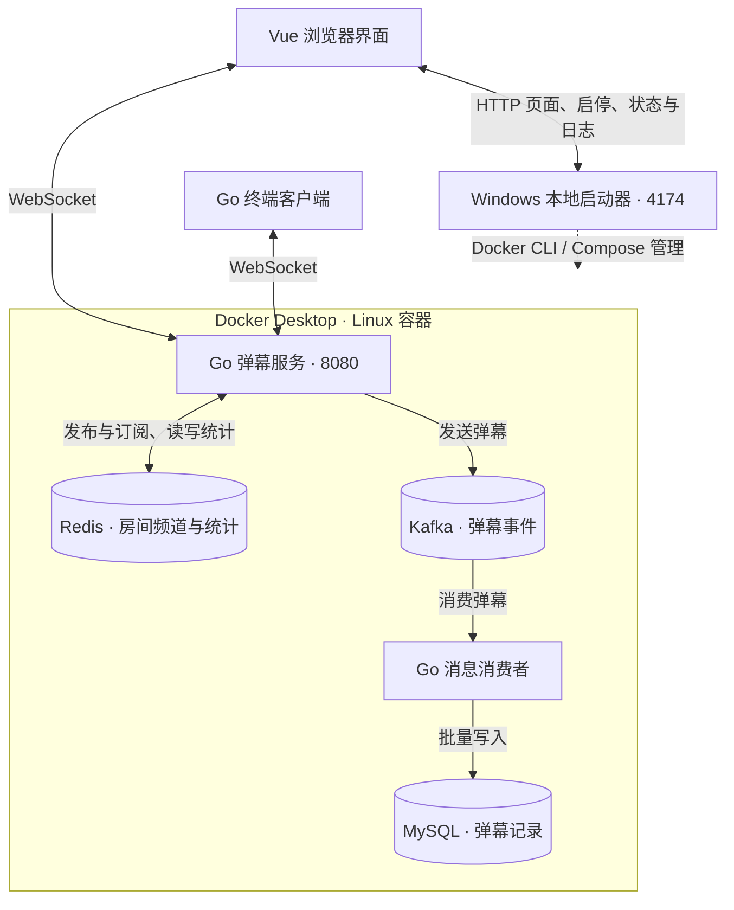
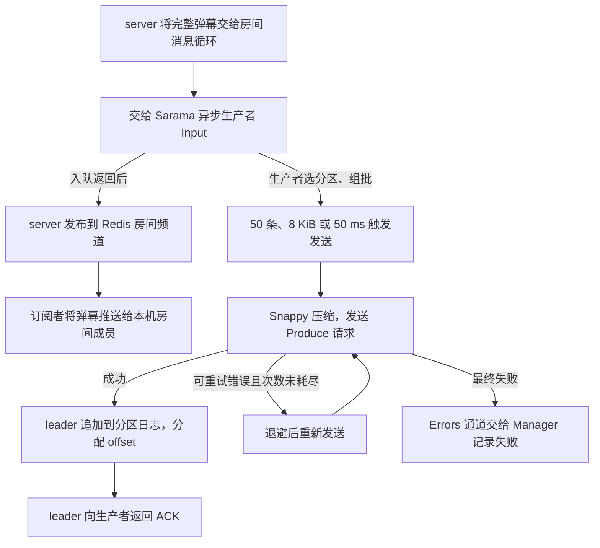
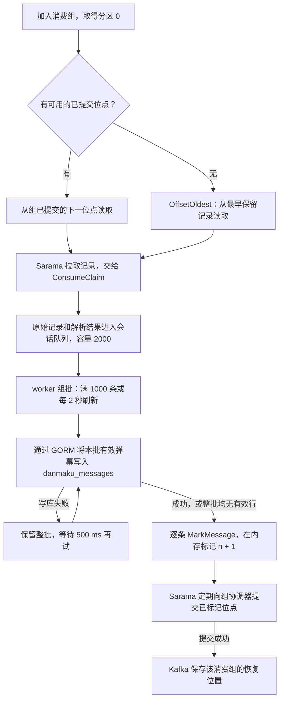
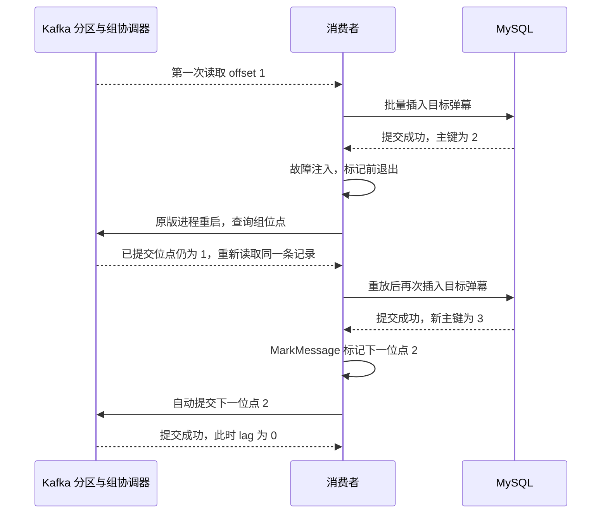
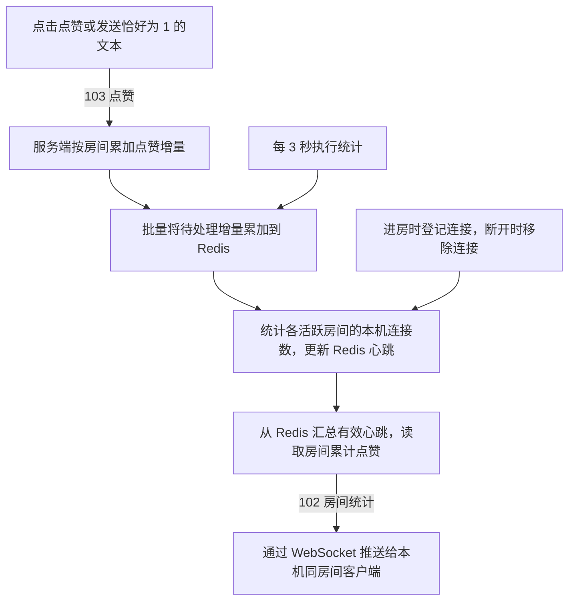
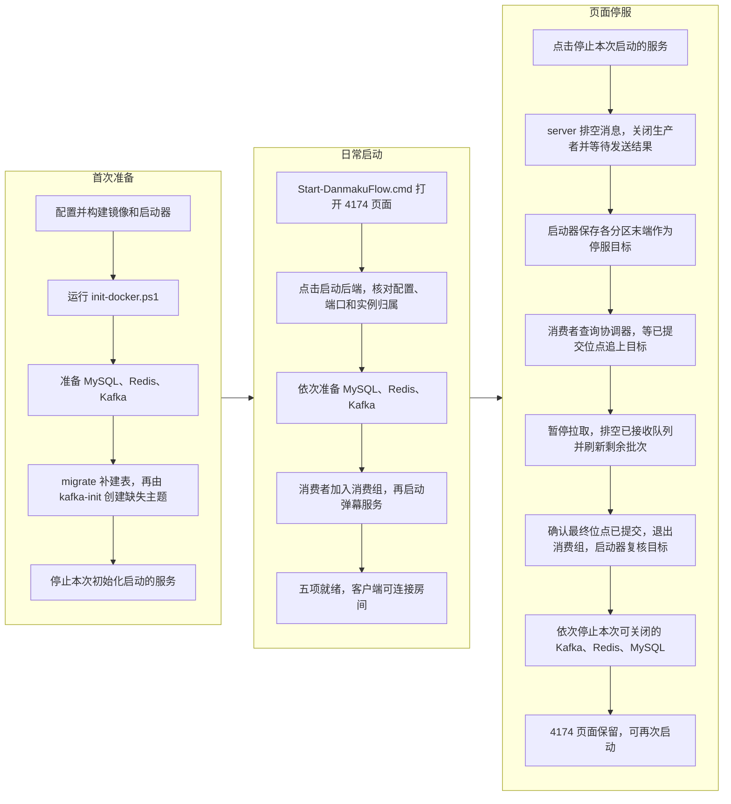

# DanmakuFlow

Go 直播弹幕项目，由 JavaLyHn 维护。支持 WebSocket 房间、弹幕广播、点赞与在线连接数统计，提供浏览器界面与终端客户端，使用 Redis 进行跨节点分发，使用 Kafka 和 MySQL 完成异步持久化。

当前以 **Go 版本为开发主线**。[DanmakuFlow-Java](https://github.com/JavaLyHn/DanmakuFlow-Java) 保留 Java 实现并暂停开发；只有收到明确的同步指令后，才将选定的 Go 改动同步到 Java。

仓库拆分、验证边界和后续事项见 [开发记录](docs/DEVELOPMENT.md)。

## 系统流程图

浏览器通过 `127.0.0.1:4174` 打开启停页面，通过 `127.0.0.1:8080/ws` 直接连接弹幕服务。终端客户端使用同一个 WebSocket 接口。Docker 中的五个常驻服务各运行一个实例。



### Kafka 弹幕持久化流程

**生产与广播。** 客户端携带 `uid` 和 `room` 连接 `/ws`。本机第一个成员进入房间时，服务端开始订阅该房间的 Redis 频道。收到 101 弹幕后，服务端用连接信息补全房间、用户和发送时间，将完整的 JSON 消息作为 Kafka 记录的 value，key 留空。点赞（103）和统计推送（102）走下方的房间统计流程。



生产者使用随机分区器。Docker 初始化任务 `kafka-init` 在主题缺失时创建 `danmaku_save_topic`，本地配置为 **1 个分区、1 个副本**，所以所有房间的弹幕都进入分区 0。每个生产请求最多包含 200 条记录。遇到可重试的发送错误，Sarama 默认最多重试 3 次，退避 100 ms。

`WaitForLocal`（`acks=1`）表示 leader 接收记录后应答。应用关闭了逐条成功回调，最终发送错误会影响服务端的停服结果。浏览器回显由 Redis 订阅触发，可以早于 Kafka 的 ACK 和 MySQL 写入。若生产者来不及接收，服务端会在写入 `Input()` 时等待，该条弹幕向 Redis 发布的时间也会推迟。[消息组装](internal/ws/router.go) · [生产者配置](internal/infra/kafka.go) · [入队、广播与错误收集](internal/ws/manager.go) · [主题初始化](docker-compose.yaml)

**消费、写库与位点提交。** `consumer` 启动时先检查 MySQL 表结构，再加入消费组 `danmaku_group_v1`。协调器分配分区后，消费者才报告就绪。下图中的 `n` 是一条记录在该分区的 offset，提交 `n + 1` 表示下次从下一条记录继续。



生产者组批用于合并网络请求，消费者组批用于合并数据库写入，两者阈值独立。消费者的 `Fetch.Default` 为每分区 5 MiB，这是拉取大小参数。同一消费组在同一时刻由一个成员处理一个分区；当前主题只有分区 0，即使增加同组消费者，也只有取得该分区的成员能处理弹幕。

当前解析失败或类型不是 101 的记录仍随批次进入位点处理，写库时跳过对应行。有效行写入失败时，本批标记推迟到重试成功。发生重平衡时，旧会话尝试排空已接收记录并限时刷新最后一批，新会话根据分配结果和已提交位点继续消费。

`MarkMessage` 更新会话内的待提交位点。项目沿用 Sarama v1.46.3 默认的自动提交（间隔 1 秒）。提交成功后，Kafka 将这个消费组在该主题、分区上的进度保存在内部主题 `__consumer_offsets`。按分区计算，`lag = 日志末端的下一位点 − 组已提交的下一位点`。MySQL 写入与 Kafka 提交分别完成，之间的间隙决定了恢复时是否重放。[消费组配置](cmd/consumer/main.go) · [组批、重试和标记](internal/consumer/handler.go) · [MySQL 批量插入](internal/repo/message_repo.go) · [Sarama 默认配置](https://github.com/IBM/sarama/blob/v1.46.3/config.go)

**异常退出时为什么会重复写入。** 2026-11-12 的隔离实验先用一条对照消息将已提交位点推进到 1，然后只发送一次目标弹幕。目标弹幕位于分区 0、offset 1，分区日志末端为 2。测试版消费者在实际写库成功与调用 `MarkMessage` 之间退出，随后由原版消费者加入同一组。



目标记录写入 Kafka 后，分区日志末端始终为 2。MySQL 中主键 2 和 3 的房间、用户、内容和发送时间完全相同。消息表使用自增主键，重放插入时会得到新主键。作为对照，位点 2 提交后再次正常重启，数据库行数保持不变。[消息表结构](internal/infra/schema.go)

<details>
<summary>点赞、在线连接数与房间统计推送</summary>



在线人数按连接计数，每个服务实例的房间心跳有效期为 7 秒。最后一个本地连接离开房间时，服务端取消该房间的 Redis 订阅。当前 Redis 使用临时存储，停止后再启动时，点赞归零，在线数随客户端重新连接而更新。

</details>

<details>
<summary>首次初始化、日常启动与有序停止</summary>



普通启动检查既有表结构和 Kafka 主题。启动器复用符合配置的已有实例，停止时保留外部实例及其仍需使用的依赖。启停中途失败时，页面提供组件状态、日志和重试入口。MySQL 和 Kafka 使用 Docker 命名卷，正常停服后数据保留。

停服目标取自 `GetOffset(OffsetNewest)`，表示每个分区末尾的下一位点。启动器保存这些目标，重试时沿用同一组数值。消费者退出后，启动器再次向协调器核对已提交位点，核对失败时保留依赖供重试。[停服目标与重试](internal/launcher/manager.go) · [消费者排空](cmd/consumer/main.go) · [退出后的位点核对](internal/launcher/docker_stop.go)

</details>

## 代码结构

| 路径 | 用途 |
| --- | --- |
| `cmd/server` | Gin / WebSocket 网关，入口为 `/ws` |
| `cmd/consumer` | Kafka 消费与 MySQL 批量持久化 |
| `cmd/migrate` | 显式补建缺失的 MySQL 表，保留已有表 |
| `cmd/client` | 交互式 WebSocket 客户端 |
| `cmd/launcher` | Windows 本机页面与受控的后端启停 |
| `web` | Vue 3 / TypeScript 房间互动界面，Vite 构建 |
| `internal/webui` | 托管构建后的页面与静态资源 |
| `cmd/benchmark` | 已有压测工具，本轮不运行 |
| `internal/ws` | 连接、房间与消息分发 |
| `internal/infra` | Redis、Kafka、MySQL 连接与表结构检查 |
| `internal/repo` | 数据库访问 |
| `internal/service` | 业务服务 |

Go 模块要求版本为 1.25.0。主要依赖为 Gin、Gorilla WebSocket、go-redis、Sarama 和 GORM。

协议地址示例：`ws://127.0.0.1:8080/ws?uid=1001&name=demo&room=1001`。101 为弹幕、102 为房间统计、103 为点赞。`uid` 是客户端提供的身份参数，尚无账号认证。回放 HTTP 接口当前未启用。

## Windows 本机启动器

本地开发采用 Docker Desktop 的 Linux 容器：MySQL、Redis、Kafka、消费者和弹幕服务各一个实例，Windows 启动器托管 4174 页面。需要 Node.js 24、Go 1.25，以及已就绪的 Docker Desktop / WSL 2。首次准备时先关闭旧启动器，再依次执行：

```powershell
.\scripts\setup-docker.ps1
.\scripts\build-docker.ps1
.\scripts\init-docker.ps1
```

配置脚本隐藏输入数据库密码，保存私有配置并备份原配置；构建脚本准备镜像和页面；初始化脚本显式补建缺失表和 Kafka 主题，完成后停止本次启动的容器。普通页面启动不执行迁移。日常仍双击 `Start-DanmakuFlow.cmd`，在页面点击“启动后端”或“停止本次启动的服务”。只停止本次拥有的实例；MySQL/Kafka 数据保留在命名卷中，原生 Windows 数据目录不会挂载或覆盖。

Docker 模式始终读取本项目保存的 DPAPI 数据库连接；终端中的其他 DSN 不会覆盖它。详细配置、首次初始化、资源上限和故障收尾见 [Docker 操作说明](docker/README.md)。约 1.7 GiB 是五个常驻容器的内存上限总和，不包含 Docker 虚拟机或镜像构建，也不是实测占用。

2026-11-09 已完成真实镜像构建、显式初始化和单实例 Docker 功能验收：两个 Edge 页面共发送 10 条弹幕、完成 2 次点赞，核对房间隔离、MySQL 落库、正常停服及重启后的数据保留。随后集成至主目录，复核日常入口、连接失败后的恢复和新增消息落库，Kafka 消费积压为 0。验收结束后五个后端服务均已停止。此次未访问原生 MySQL 数据或 Kafka 备份，没有导入旧数据，也没有运行压测。范围和结果见 [开发记录](docs/DEVELOPMENT.md)。

### 保留的原生运行方式

旧的 native 配置仍可使用本机 MySQL、Redis、Kafka 和 Java。原生 Windows Kafka 存在已记录的日志文件重命名问题，当前迁移使用 Linux 容器解决运行环境限制。原生模式在仓库根目录构建（不会启动服务）：

```powershell
.\scripts\build-local.ps1
```

双击 `Start-DanmakuFlow.cmd`，首次运行按提示填写各程序和配置文件的绝对路径，并隐藏输入完整 MySQL DSN。配置与凭据保存在 `.local/`，凭据由 Windows 当前用户的 DPAPI 加密，目录权限限于当前用户和 SYSTEM。DSN 须指向本机 `127.0.0.1:3306` 或 `localhost:3306` 上已有的数据库。修改配置可运行 `.\scripts\setup-local.ps1`，按提示选择是否替换已有配置或凭据。启动时优先使用进程环境中已有的 `DANMAKUFLOW_MYSQL_DSN`。

日常双击入口打开 `http://127.0.0.1:4174/`，点击“启动后端”；使用后点击“停止本次启动的服务”。页面显示组件状态及日志。启动器可复用符合配置的现有服务，只停止由启动器拥有的进程，不停止外部服务。刷新或关闭网页不会停止后端。部分启动或停止失败时，查看提示和日志，解决问题后重试；超时会保留进程和相关依赖，不会强杀。页面无法打开时检查 `.local/launcher.stderr.log`、4174 端口和 Windows 应用控制提示。入口不会自动构建；缺少产物时重新运行构建脚本。

当前 Redis 配置未启用持久化，停止后点赞和在线统计不会保留；MySQL 中已落库的弹幕保留。启动器不会自动迁移数据库、格式化 Kafka、创建数据库或 topic；表初始化须按 [数据库操作指南](docs/DATABASE.md) 显式执行。脚本不包含执行策略绕过参数。

## 浏览器界面

使用 Node.js 24，在仓库根目录执行：

```powershell
cd web
npm ci
npm run build
cd ..
```

在原有数据库及 Redis/Kafka 环境已经配置就绪时，沿用服务端启动方式：

```powershell
go run ./cmd/server -port 8080
```

浏览器打开 `http://127.0.0.1:8080/`，填写端口、房间 ID、用户 ID 后点击“连接房间”。UID 可留空自动生成。页面与终端连接同一个 `/ws`：Enter 或发送按钮提交原文，只有恰好输入 `1` 才点赞；点赞按钮不会清除草稿。消息和统计等待服务端推送，不显示模拟数据。

页面采用直播间布局，视频区仅为静态占位，没有视频播放或推流能力。当前范围是本机客户端，WebSocket 主机固定为 `127.0.0.1`；在其他机器访问页面不会自动连接到部署机器。身份参数不代表登录认证。

生产运行不需要 Node 常驻：部署 Go 程序与 `web/dist`，从仓库根目录启动；其他目录可指定 `-web-dir <构建目录绝对路径>`。未构建页面时，Go 服务记录提示并继续支持终端。只提供首页与构建资源，不提供源文件或目录浏览。

前端开发可在 `web` 内运行 `npm run dev`，按输出的本机地址打开页面，再连接已有的 Go 服务。`npm test` 是串行单元测试；`npm run build` 同时检查类型。浏览器回归在 GitHub Actions 中用单个 Chromium worker 和模拟 WebSocket 执行，不依赖 MySQL、Redis 或 Kafka。

消息按接收顺序批量显示，滚动到旧消息时不会强制跳回底部。为保持简单，会话内容一直保留到下一次连接，没有历史存储、消息淘汰或虚拟列表框架；长时间持续接收大量消息会增加浏览器内存。UID 和 uint64 统计按原始精度处理。浏览器网络错误只展示实际可用的信息，不推断底层失败原因。

## 数据库配置与运行限制

服务端、消费者和迁移命令均要求设置 `DANMAKUFLOW_MYSQL_DSN`，不再使用内置数据库地址或口令。正常启动只连接数据库并检查三张表的必需列，不执行建表、改表或数据重置；缺少表或列时启动失败。

首次初始化由独立的 `go run ./cmd/migrate` 显式补建缺失表。它不创建数据库，不修改已有表，也不提供清空数据的命令。配置示例、账户权限、已有数据库接入和检查范围见 [数据库操作指南](docs/DATABASE.md)。

2026-11-06 的数据库修复阶段仅进行单进程轻量测试与编译；2026-11-09 已按后续授权，在独立 Docker 数据卷中验证真实 MySQL 初始化、消息写入和重启保留。该结果仅覆盖本次开发配置，不代表任意已有数据库的结构与权限均兼容。压测和基准测试仍未恢复。

服务入口是 `cmd/server`、`cmd/consumer`；根目录 `main.go` 仅输出运行时信息。性能优化是后续工作目标，现阶段不承诺未经测量的连接数或吞吐量。

## 许可

采用 [MIT License](LICENSE)，分发时保留已有版权和许可声明。
